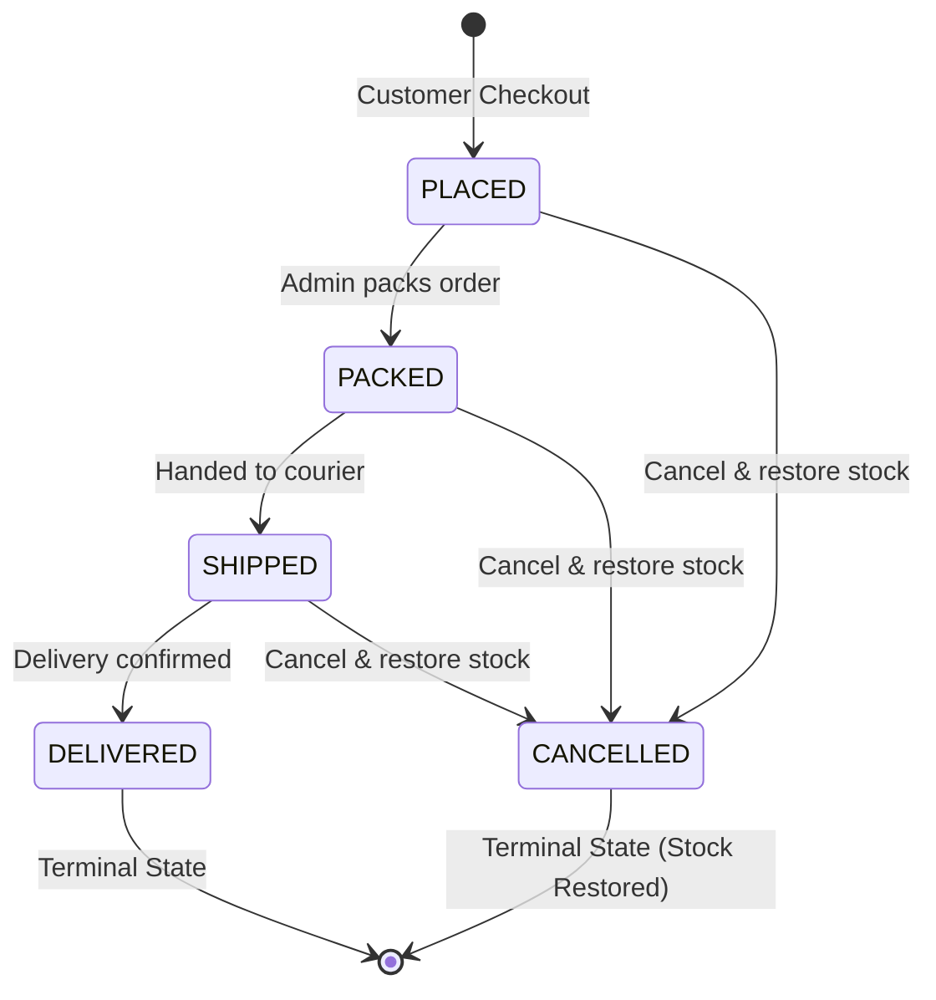

# ShopEase — System Architecture & Implementation Guide (MERN Stack)

## 1. Executive Summary

**ShopEase** is a production-grade, full-stack e-commerce web application rebuilt from the ground up using the **MERN stack** (MongoDB, Express.js, React.js, and Node.js). It replaces an enterprise Java/JSP/Oracle XE architecture while preserving the complete brand identity, visual aesthetics, catalogs, workflows, and business rules of the reference application.

---

## 2. Technology Stack Comparison

| Architectural Dimension | Reference Java Architecture | New MERN Stack Implementation |
|---|---|---|
| **Frontend Runtime** | JavaServer Pages (JSP), JSTL | React 18, Vite |
| **Styling & Layout** | Bootstrap 5.3.3, Vanilla CSS, Icons | Bootstrap 5.3.3, Bootstrap Icons, Custom CSS |
| **Frontend State** | HTTP Session (`HttpSession`) | React Context API (`AuthContext`, `CartContext`) |
| **Routing** | Servlet Container Path Mapping (`web.xml`) | React Router DOM v6 with Client-Side Routing |
| **Backend Runtime** | Java 21, Apache Tomcat 9.0.120 | Node.js v24 LTS |
| **HTTP Framework** | Java Servlets 4.0 (`javax.servlet.*`) | Express.js 4.21 RESTful API |
| **Database** | Oracle Database XE 10g | MongoDB Community Server 9.0 |
| **Persistence Layer** | Raw JDBC with `PreparedStatement` | Mongoose 8 ODM with Schema Validation |
| **Authentication** | Container Session Cookie (`JSESSIONID`) | Cryptographically Signed JWT in HTTP-Only Cookie |
| **Password Security** | BCrypt (`jbcrypt:0.4`, 10 rounds) | BCrypt (`bcryptjs`, 10 rounds) |
| **Multipart Uploads** | Apache Commons FileUpload / Servlet 3.0 | Multer with 2MB limits and MIME type check |
| **API Architecture** | Server-Side Rendered HTML | RESTful JSON APIs under `/api/v1` |

---

## 3. System Architecture Diagram

```
+--------------------------------------------------------------------------------+
|                             USER BROWSER / CLIENT                              |
|   React 18 SPA (Vite)  *  Bootstrap 5.3.3  *  React Router v6  *  Context API   |
+--------------------------------------------------------------------------------+
               |                                            ^
               | HTTP Requests                              | JSON Responses / Cookies
               v                                            |
+--------------------------------------------------------------------------------+
|                             EXPRESS.JS REST API SERVER                         |
|                               (Node.js v24 @ Port 5000)                        |
|                                                                                |
|  [Security Middlewares]                                                        |
|   * Helmet (Secure Headers)     * CORS (Credential Support)                   |
|   * Cookie Parser               * Express Rate Limiter (Brute-force defense)   |
|   * Multer (2MB Image Upload)   * Centralized Error Handler                    |
|                                                                                |
|  [Auth & Role Verification]                                                    |
|   * JWT Verifier (extracts from httpOnly cookie or Bearer header)              |
|   * Admin Authorization Guard (enforces role === 'ADMIN')                      |
|                                                                                |
|  [API Routes / Controllers]                                                    |
|   * /api/v1/auth        (register, login, logout, me)                          |
|   * /api/v1/categories  (public catalog categories)                            |
|   * /api/v1/products    (catalog search, filter, sort, pagination, detail)     |
|   * /api/v1/cart        (persistent database shopping cart)                    |
|   * /api/v1/checkout    (concurrency-safe atomic checkout)                     |
|   * /api/v1/orders      (customer order history and details)                   |
|   * /api/v1/profile     (customer profile and password update)                 |
|   * /api/v1/admin/*     (dashboard, products, categories, orders, users)       |
+--------------------------------------------------------------------------------+
                                       |
                                       | Mongoose ODM (BSON)
                                       v
+--------------------------------------------------------------------------------+
|                             MONGODB COMMUNITY SERVER                           |
|                               (Port 27017: shopease)                           |
|                                                                                |
|  Collections:                                                                  |
|   * users       (email unique index, role enum, passwordHash select:false)     |
|   * categories  (name unique index, categoryId sequence)                       |
|   * products    (text index on name/desc, category ref, stock, active flag)    |
|   * carts       (user unique ref, embedded items array)                        |
|   * orders      (orderNumber unique, user ref, status enum, items snapshot)    |
+--------------------------------------------------------------------------------+
```

---

## 4. MongoDB Data Models & Schema Design

### 4.1 User Schema (`models/User.js`)
- `name`: String, required, trim, 2-100 characters
- `email`: String, required, unique, lowercase, RFC 5322 regex validation, indexed
- `passwordHash`: String, required, excluded from default queries via `select: false`
- `phone`: String, optional, max 20 characters
- `role`: String enum (`'ADMIN'`, `'CUSTOMER'`), default: `'CUSTOMER'`, indexed
- `createdAt`, `updatedAt`: Timestamps

### 4.2 Category Schema (`models/Category.js`)
- `name`: String, required, unique, trim, indexed
- `description`: String, trim, max 500 characters
- `categoryId`: Number, sequential identifier (1..10)
- `createdAt`, `updatedAt`: Timestamps

### 4.3 Product Schema (`models/Product.js`)
- `name`: String, required, trim, min 2 characters
- `category`: ObjectId ref to Category, required, indexed
- `description`: String, trim
- `price`: Number, required, non-negative
- `stockQty`: Number, required, non-negative integer
- `imagePath`: String, relative asset path or upload path
- `isActive`: Boolean, default true (supports soft deactivation)
- `productId`: Number, sequential identifier (1..85+)
- Compound & Text Indexes:
  - `{ name: 'text', description: 'text' }` for search
  - `{ category: 1, isActive: 1 }` for category filtering
  - `{ price: 1 }` for sorting

### 4.4 Cart Schema (`models/Cart.js`)
- `user`: ObjectId ref to User, required, unique index (one cart per customer)
- `items`: Array of embedded subdocuments:
  - `product`: ObjectId ref to Product, required
  - `quantity`: Number, required, min 1
- `createdAt`, `updatedAt`: Timestamps

### 4.5 Order Schema (`models/Order.js`)
- `orderNumber`: Number, unique sequential human-friendly number (`1001`, `1002`, ...)
- `user`: ObjectId ref to User, required, indexed
- `customerName`: String (immutable purchase-time snapshot)
- `customerEmail`: String (immutable purchase-time snapshot)
- `customerPhone`: String (immutable purchase-time snapshot)
- `shippingAddress`: String, required, min 5 characters
- `paymentMethod`: String enum (`'COD'`, `'MOCK'`), required
- `status`: String enum (`'PLACED'`, `'PACKED'`, `'SHIPPED'`, `'DELIVERED'`, `'CANCELLED'`), default `'PLACED'`
- `totalAmount`: Number, required, calculated server-side
- `items`: Array of purchase-time snapshots:
  - `product`: ObjectId ref to Product
  - `productId`: Number
  - `productName`: String
  - `productImage`: String
  - `categoryName`: String
  - `quantity`: Number
  - `unitPrice`: Number (historical price lock)
  - `subtotal`: Number
- `orderDate`: Date, default `Date.now`, indexed

---

## 5. Order Fulfillment Finite State Machine

The order lifecycle adheres strictly to the state transition rules from the reference enterprise project:



### Business Rule Enforcement:
1. Terminal states (`DELIVERED`, `CANCELLED`) cannot be modified further.
2. Status transitions skipping steps (e.g. `PLACED` &rarr; `DELIVERED` or `SHIPPED` &rarr; `PLACED`) are rejected with HTTP 400.
3. When any order is changed to `CANCELLED`, each item's purchased quantity is automatically replenished into the product catalog inventory via `$inc: { stockQty: item.quantity }`.

---

## 6. Security Architecture

1. **Authentication via HTTP-Only Cookies**: JWT tokens are issued with `httpOnly: true`, `sameSite: 'lax'`, preventing XSS token exfiltration.
2. **Password Cryptography**: Passwords are never stored in plaintext and never logged. BCrypt with 10 salt rounds is applied during registration and updates.
3. **Privilege Escalation Defense**: Self-registration endpoints strictly hardcode `role = 'CUSTOMER'`.
4. **Role-Based Access Control (RBAC)**: All `/api/v1/admin/*` routes pass through `authorizeAdmin`, which verifies `req.user.role === 'ADMIN'` and returns HTTP 403 on violations.
5. **Horizontal Privilege Enforcement**: Customers can only view and manage their own orders (`order.user === currentUser.id`). Unauthorized access returns HTTP 403.
6. **Referential Integrity**: Category deletion is blocked if any active products are associated with the category.
7. **Rate Limiting**: Authentication endpoints are rate-limited to 100 requests per 15 minutes to prevent brute-force attacks.
8. **MIME & Upload Safety**: Multer validates file extensions, restricts MIME types to `image/jpeg`, `image/png`, `image/webp`, enforces a 2MB maximum limit, and generates cryptographic UUID filenames.

---

## 7. Verification & Automated Testing

The backend includes a comprehensive 17-point automated test suite (`server/src/tests/api.test.js`) covering:
- Health check and environment verification
- Customer and Admin JWT login and cookie assignment
- Duplicate email rejection on registration
- Product search, filtering, and ROWNUM-style pagination
- Persistent cart lifecycle (add, update, remove, clear)
- Concurrency-safe checkout with inventory reservation
- Order ownership restriction and security verification
- Customer profile and password modification
- Admin dashboard database aggregations
- Referential integrity enforcement on category deletion
- Finite state machine transitions and inventory restoration on cancellation
- Password hash omission from directory audits
